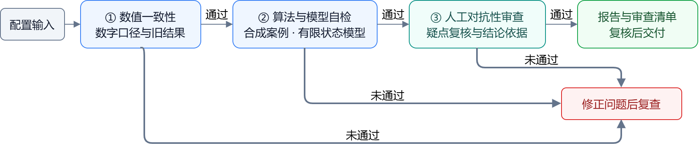

# 进阶使用

首次体验建议先运行 [README 的一条命令演示](../README.md#快速开始)。本文保留完整门禁流程和独立脚本用法；命令均从仓库根目录运行，`python` 指已安装依赖的虚拟环境解释器。

## 三层门禁

| 层级 | 实现 | 检查内容 |
|---|---|---|
| 数值一致性 | `scripts/check_consistency.py` | 权威数字出现情况、废弃数字/文本残留、孤儿数字候选 |
| 算法与模型自检 | `scripts/synthetic_check.py` | 已知答案还原误差、有限模型、实际执行轨迹 |
| 对抗性审查 | 人工或 AI 辅助整理 | 质疑核心结论，记录依据与待补事项 |



[draw.io 可编辑源文件](workflow.drawio)。第二层按配置执行；两个脚本各自生成报告，第三层及整体交付判断由人工完成。

整套门禁通过要求：一致性无 FAIL、第二层所配检查全部通过、WARN/孤儿候选已复核、对抗清单已有答辩依据。执行出错时不能用旧报告替代本次证据。

## 数字一致性与模型正反例

```text
python -X utf8 scripts/check_consistency.py --config examples/microservice_order/gate_config.json
python -X utf8 scripts/synthetic_check.py --config examples/microservice_order/gate_config.json
```

预期两个脚本退出 `0`，正确模型声明 4 个组合、穷尽 3 个可达状态。报告位于示例的 `reports/pass/`。

```text
python -X utf8 scripts/synthetic_check.py --config examples/microservice_order/gate_config_buggy.json
```

此负例修改了模型的付款守卫，预期 FAIL、退出 `1`，反例为“初始状态 → 未付款直接发货”，关联 `REQ-ORDER-001`。报告位于 `reports/negative_control/`。人工复核示例见[对抗性审查清单](../examples/microservice_order/docs/对抗性审查清单.md)。

## 分步生成与检查实际轨迹

```text
python -X utf8 examples/microservice_order/order_program.py --scenario normal --out examples/microservice_order/reports/normal_trace.json
python -X utf8 scripts/synthetic_check.py --config examples/microservice_order/gate_config_trace.json
```

预期模型 PASS、轨迹 PASS、检查器退出 `0`，报告位于 `reports/trace_pass/`。

```text
python -X utf8 examples/microservice_order/order_program.py --scenario unpaid_shipping --out examples/microservice_order/reports/unpaid_shipping_trace.json
python -X utf8 scripts/synthetic_check.py --config examples/microservice_order/gate_config_trace_buggy.json
```

预期模型仍 PASS、轨迹 FAIL、检查器退出 `1`，报告位于 `reports/trace_negative_control/`。生成轨迹成功不代表验证通过，须检查第二条命令结果。分步命令会重用各自固定输出位置；需要保留每次记录时优先用演示入口的独立目录。

模型 BFS 的反例是模型中最短的动作路径；轨迹报告给出本次运行首次违规的位置及执行前缀，两者不能混称。

## 算法与光学案例

通用算法使用 `generic_check` 配置可信的本地模块、函数、已知真值与误差阈值，参见[配置说明](configuration.md#通用算法自检)。

光学模板包含 9 个还原案例和 kurtosis 判据：

```text
python -X utf8 scripts/synthetic_check.py --config references/gate_config.example.json --outdir ../evals/optical_smoke
```

输出位于仓库的 `evals/optical_smoke/`。模板中的光学路径、旧数字是示例，接入自己的项目时必须替换；模型/轨迹入门不需要复制这份综合模板。

## 配置、判定与报告

两个检查脚本均支持 `--config`、`--outdir`。配置中的相对路径及检查脚本的相对 `--outdir` 以**配置文件所在目录**为基准，后者覆盖 `output_dir`。
第二层至少配置一项光学检查、`generic_check` 或 `model_check`；`trace_check` 必须同时配置模型及非空 `terminals`。未配置的检查不会显示为已运行。

| 检查 | 判定规则 |
|---|---|
| 一致性 | 旧数字/文本命中即 FAIL；核心数字缺失为 WARN；孤儿数字为复核候选 |
| 算法自检 | 误差严格小于阈值；空案例、非有限值、形状不符及算法异常不能通过 |
| 模型检查 | 不变量违例或非终止死锁为 FAIL；达到状态上限为 INCONCLUSIVE |
| 轨迹检查 | 动作、守卫、状态、连续性或不变量违规为 FAIL；合法未终止为 INCONCLUSIVE |

| 检查脚本退出码 | 含义 |
|---|---|
| `0` | 该脚本通过；一致性仍可能包含 WARN/候选 |
| `1` | 检查失败或未完成（包括 INCONCLUSIVE） |
| `2` | 配置/输入错误 |

输出包括 `门禁报告_一致性.md`、`门禁报告_合成自检.json` 和人工整理的 `对抗性审查清单.md`。
JSON 包含已运行检查、误差、模型反例或轨迹违规位置，以及配置/模型/轨迹的 SHA-256。报告含本机路径和时间戳，不随源码提交。

## 作为 Skill 使用

仓库提供 [SKILL.md](../SKILL.md)。将完整仓库放入目标环境支持的 Skill 目录，仍需按 README 安装依赖；仅复制 `SKILL.md` 不包含执行脚本。
Claude Code 可使用 `~/.claude/skills/verification-gate-review/`，其他环境按各自约定处理。
明确要求“跑门禁”或“用 verification-gate”调用；该 Skill 仅手动触发，不因普通“检查/审查”措辞自动执行。

返回[快速开始](../README.md#快速开始)或阅读[完整配置语义](configuration.md)。
